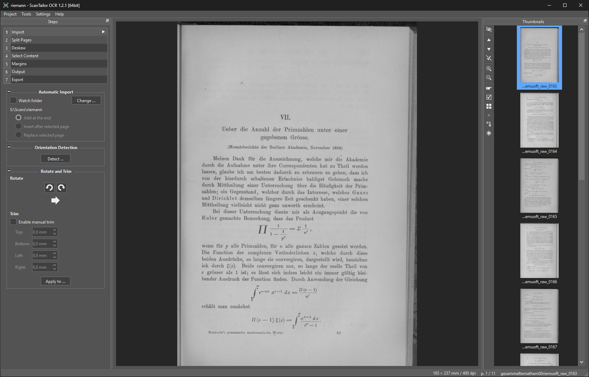

# The Main Window

{ .shot }

The window has four areas:

| Area | Where | What it does |
|---|---|---|
| **Steps** | top left | The seven steps. Click one to switch to it. |
| **Options panel** | left, below the steps | The settings of the current step for the current page. |
| **Page view** | middle | The current page as the step sees it. Most steps let you edit it with the mouse. |
| **Thumbnails** | right | All pages of the project. Click one to show it. |

At the bottom, the **status bar** shows the mouse position, the size and resolution of
the image, the page number and the file name. A wrong resolution is easy to spot there
in every step.

## Menus

| Menu | Entries |
|---|---|
| **Project** | New Project, Open Project, Save Project, Save Project As, Close Project, Exit |
| **Tools** | [Fix DPI of All Images](../reference/tools.md#fix-dpi-of-all-images), [Relink](../reference/tools.md#relink) |
| **Settings** | [Program Settings](../reference/program-settings.md), [Default Parameters](../reference/default-parameters.md) |
| **Help** | About ScanTailor OCR |

## Steps and batch processing

Clicking a step processes the **current page** up to that step and shows the result.
The **play button** (▶) next to the selected step processes **all pages** up to that
step, one after the other. While it runs, the button stops the batch processing.

Each step builds on the one before. If you change something in an earlier step, the
later steps redo their work for the pages concerned the next time they are shown or
processed.

!!! note "Output needs the page sizes"
    The Output step can only work once the final size of all pages is known. If it says
    so, run the batch processing in *Select Content* or *Margins* first.

## The page view

- **Zoom** with the mouse wheel or with ++plus++ and ++minus++.
- **Move** a zoomed page by dragging it.
- **Double-click** to see the whole page again (not in *Select Content* and *Margins*,
  where double-click has its own job).

The hints in the status bar tell you what the mouse does in each step.

## Thumbnails

The toolbar left of the thumbnails has, from top to bottom:

| Button | Function |
|---|---|
| Eye | Keep the current page in view while you work |
| ▲ ▼ | Previous / next page |
| Crossed arrows | Navigate through the selected pages only |
| Magnifier + / − | Larger / smaller thumbnails (++ctrl+plus++ / ++ctrl+minus++) |
| Hand | Go to page ... (++ctrl+g++) |
| Check box | Multi-page selection mode (select pages with a click, without ++ctrl++) |
| Grid | One or several columns of thumbnails |
| Dot | Pause the automatic reordering while thumbnails refresh |
| Sort | Sorting order of the thumbnails (see below) |
| Asterisk | Highlight pages that deviate strongly from the others |

### Sorting order

Each step offers its own useful orders, for example:

- *Split Pages*: by page type (single pages, pages with a strip to cut off, two-page
  scans)
- *Deskew*, *Select Content*, *Margins*: by decreasing deviation, by width or by height
- *Output*: by completeness (processed pages first) or by color mode

Sorting by deviation is the fastest way to find the few pages that went wrong in a
long book: they come first.

### Selecting pages

- ++ctrl++ + click adds or removes a page from the selection, ++shift++ + click selects a
  range.
- The context menu of a thumbnail has a submenu **Select** with *All Pages*, *This Page
  and the Following Ones*, *Every Other Page (Odd Pages)*, *Every Other Page (Even
  Pages)*, *This Page and Every Other Following Page*, *Every Other Selected Page* and
  *This Page Only*.

### Adding and removing pages

The context menu of a thumbnail also has **Insert Before ...**, **Insert After ...** and
**Remove from Project ...**. Removing a page deletes its output files; the scanned image
itself stays on the disk.

## Options panels and "Apply to ..."

Each options panel holds the settings of one topic. Its last line is an
**Apply to ...** button, which copies exactly the settings of that panel from the current
page to other pages. It offers the same choices everywhere:

- This page only
- All pages
- This page and the following ones
- This page and every other following page
- Every other page (odd pages) / (even pages)
- Selected pages
- Every other selected page

"Every other" is handy for books scanned as single pages, where left and right pages
need different settings, for example different margins.

!!! tip
    If several pages are selected, the *Apply to* window opens with **Selected pages**
    already chosen.

Settings that don't apply to the current situation are grayed out, not hidden, so the
panels always look the same.

## Program-wide and project-wide settings

Settings live in three places:

| Where | What | Where to change it |
|---|---|---|
| **Per page** | Almost everything in the options panels | The options panel of the step |
| **Per project** | Page order, TIFF and PDF compression, export formats, OCR languages, color mode detection | The panels that say "applies to the whole project" |
| **Program** | Language, units, colors, threads, auto-save | [Program Settings](../reference/program-settings.md) |

New pages and new projects start with the values of the
[Default Parameters](../reference/default-parameters.md).
