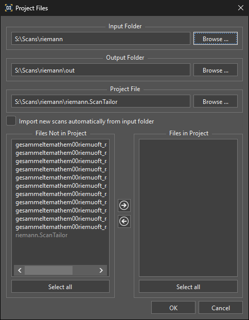

# Projects

A **project** is one book or document. It is saved as a single file ending in
`.ScanTailor` and remembers:

- which images belong to it, and in which order,
- every setting of every page,
- the settings of the whole project (compression, export formats, OCR languages, ...),
- the **start values** that new pages get.

The images themselves are not copied into the project. They stay where they are; the
project only refers to them.

## Creating a project

*Project > New Project ...* (++ctrl+n++) opens the *Project Files* window.

{ .shot width="380" }

| Field | Meaning |
|---|---|
| **Input Folder** | The folder with the scans. |
| **Output Folder** | Where the cleaned pages are written. Default: `out` inside the input folder. It must not be the input folder itself. |
| **Project File** | The `.ScanTailor` file. Default: inside the input folder, named after it. An existing file is only overwritten after asking. |
| **Import new scans automatically from input folder** | Watches the input folder and adds new scans as they arrive (see below). The project may then start empty. |
| **Files Not in Project / Files in Project** | Move the images you want with the arrow buttons. |

Supported image formats include TIFF (also multi-page TIFF), JPEG, PNG and JPEG 2000. Images
may be at most 32767 pixels wide or high and 600 megapixels in total, which is more than
an A0 page at 600 DPI.

!!! note "File names"
    New file and folder names are checked against the rules of Windows on every system,
    so projects and exports can move between computers. Names may not contain
    `\ / : * ? " < > |`, may not be reserved names such as `CON` or `NUL`, and may not
    end with a period or a space.

## The resolution (DPI) of the images

ScanTailor OCR needs to know the resolution of each scan to turn millimeters into pixels.
Most scanners write it into the file. If it is missing or implausible, the
[Fix DPI](../reference/tools.md#fix-dpi-of-all-images) window opens so you can enter it.

## Opening, saving, closing

| Command | Shortcut |
|---|---|
| Open Project ... | ++ctrl+o++ |
| Save Project | ++ctrl+s++ |
| Save Project As ... | |
| Close Project | ++ctrl+w++ |
| Exit ScanTailor OCR | ++ctrl+q++ |

The start page lists the recent projects. Projects are saved safely: the old file is
only replaced once the new one is completely written.

**Auto-save** saves the project one minute after you worked on it, without asking. Turn
it on in [Program Settings](../reference/program-settings.md). A new project is
auto-saved only after you saved it once.

## Automatic import of new scans

ScanTailor OCR can watch a folder and add each new scan to the project as soon as the
scanning program has finished writing it. You can scan and process at the same time.

Turn it on in step **1 Import**, panel **Automatic Import**, with **Watch folder**.
**Change ...** chooses the folder. Where new scans go:

| Option | What happens |
|---|---|
| **Add at the end** | Each new scan becomes the last page. |
| **Insert after selected page** | New scans follow the selected page, one after the other. They are renamed after it (`<page name>_<scan name>.tif`), so they also sort after it in the folder. Selecting another page continues there. |
| **Replace selected page** | The next scan takes the place of the selected page(s). The old image is moved to a folder `replaced` next to it, and its output files are deleted. Useful to re-scan a bad page. |

The project is saved after each scan. The import is off whenever a project is opened,
so it never adds files by surprise. When you turn it on, images that are already in the
folder but not in the project can be chosen once.

## Moving a project

If you move the project file, the images or the output folder, ScanTailor OCR asks you
to **relink** the project when you open it. See [Relink](../reference/tools.md#relink).

## Projects from ScanTailor Advanced

ScanTailor OCR opens projects of ScanTailor Advanced 1.1 and 1.2 and of older versions of
ScanTailor OCR. Before it opens such a project, it tells you:

- some settings are processed differently, so results can differ;
- settings the old project doesn't have come from the active profile of the
  [Default Parameters](../reference/default-parameters.md);
- once the project is saved (also automatically), ScanTailor Advanced can no longer
  open it.

It offers to make a **backup copy** first (`Book_BACKUP.ScanTailor` next to
`Book.ScanTailor`). The backup stays usable in ScanTailor Advanced.
