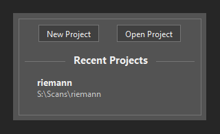
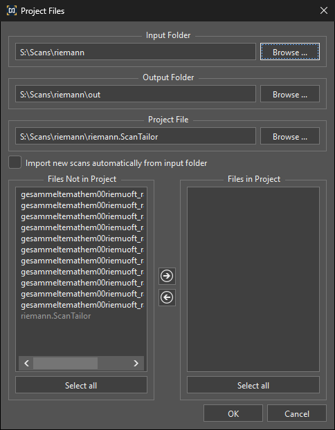
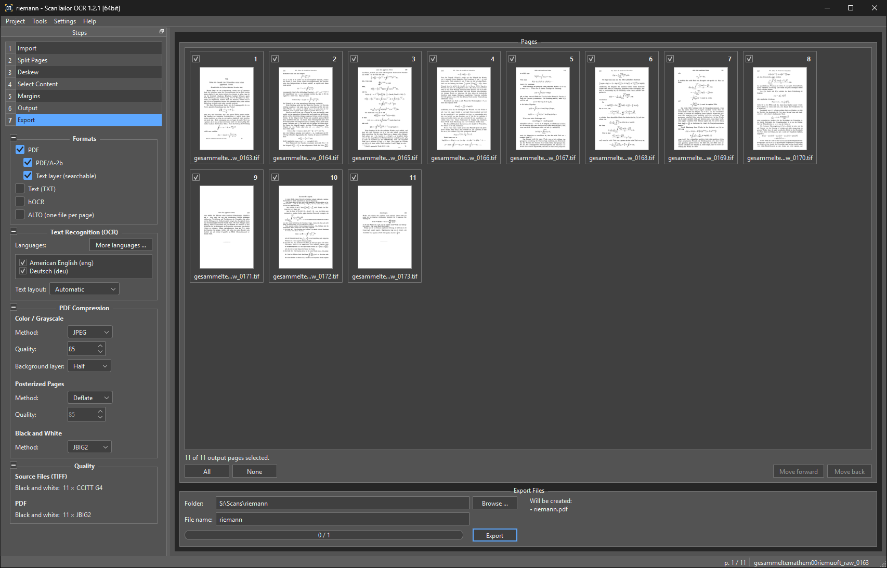

# Quick Start

This walkthrough takes a folder of scans to a searchable PDF with the default settings.
For most printed books, that already gives a good result. Each step links to its own
page for the details.

!!! info "Before you scan"
    - Scan at **300 to 600 DPI**. 300 DPI is enough for normal print; small print,
      footnotes and formulas profit from 400 to 600 DPI.
    - Scan in **grayscale** or color, not in black and white. ScanTailor OCR makes the
      black and white version itself, and it does that better from a grayscale image.
    - Put all scans of a book into **one folder**, named so that they sort in page order
      (`scan_001.tif`, `scan_002.tif`, ...).

## 1. Create the project

Start ScanTailor OCR and click **New Project**.

{ .shot width="320" }

In the *Project Files* window:

1. Choose the **Input Folder** with your scans. The **Output Folder** (`out` inside it)
   and the **Project File** are filled in for you.
2. Move the images from *Files Not in Project* to *Files in Project* with the arrow
   button. *Select all* selects all of them at once.
3. Click **OK**.

{ .shot width="380" }

If ScanTailor OCR asks for the resolution of some images, see
[Fix DPI](../reference/tools.md#fix-dpi-of-all-images).

## 2. Let the steps run

The steps are listed at the top left. Each step has a **play button** (▶) next to its
name: it runs this step, and all steps before it, for **all pages**.

The quickest way is to select step **6 Output** and click its play button. ScanTailor
OCR then rotates, splits, straightens and crops all pages and writes the cleaned pages
into the output folder. The thumbnails on the right fill in as it goes.

!!! tip "Better: check as you go"
    Running the steps one by one lets you catch problems early, while they are easy to
    fix. Run step 2, look over the thumbnails, run step 3, and so on. A wrong split line
    in step 2 is a one-click fix there, but causes cropped text in every later step.

What to check in each step:

| Step | Look for |
|---|---|
| [2 Split Pages](../steps/split-pages.md) | Two-page scans split at the spine; single pages not split |
| [3 Deskew](../steps/deskew.md) | Lines of text horizontal |
| [4 Select Content](../steps/select-content.md) | The blue box around all the text, nothing cut off, no dirt inside |
| [5 Margins](../steps/margins.md) | Margins and page size as you want them |
| [6 Output](../steps/output.md) | Clean black and white text; pictures kept |

The thumbnail toolbar can sort the pages so that unusual ones come first, for example
by deviation in *Deskew* or by width in *Select Content*. That makes outliers easy to
find in a long book.

## 3. Export the PDF

Select step **7 Export**.

1. Under **Formats**, keep **PDF** and **Text layer (searchable)** ticked.
2. Under **Text Recognition (OCR)**, tick the language(s) of the book.
3. Check the **Folder** and **File name** at the bottom.
4. Click **Export**.

{ .shot }

When the export has finished, the created files are listed as links below the
**Export** button.

## Next steps

- Pages with pictures? Set them to *Mixed* in [Output](../steps/output.md#color-mode).
- Uneven lighting, yellowed paper or a dark spine? See
  [Binarization](../methods/binarization.md) and
  [Enhancement Filters](../methods/enhancement.md).
- Bent lines near the spine? See [Dewarping](../methods/dewarping.md).
- Want the same settings for every new book? Save them as a profile in the
  [Default Parameters](../reference/default-parameters.md).
