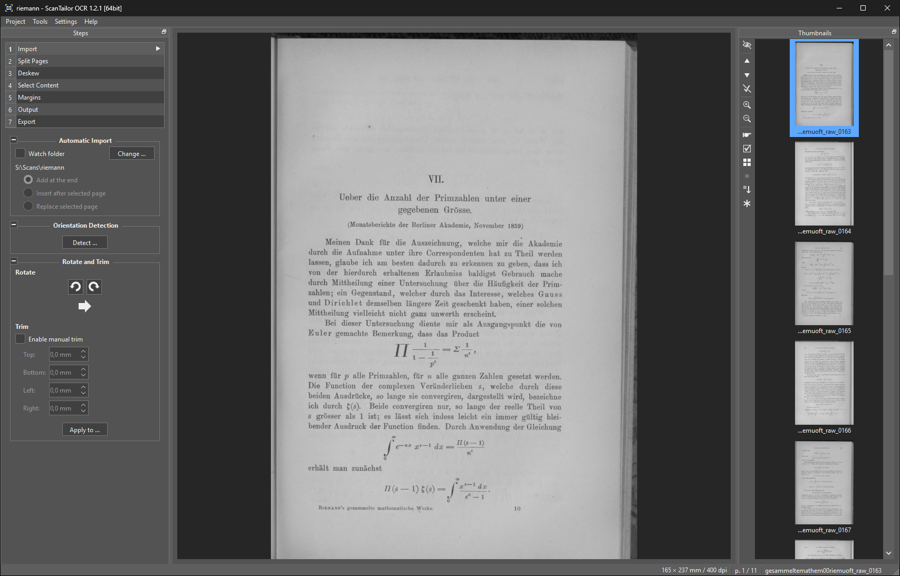

# ScanTailor OCR Manual

ScanTailor OCR turns raw scans of books and documents into clean pages and a
**compact, searchable PDF**. You give it the images from your scanner; it straightens
them, crops them, removes dirt and shadows, converts them to crisp black and white
where that fits, recognizes the text and writes the PDF.

{ .shot }

## How it works in one sentence

A project goes through **seven steps**, one after the other. Each step does one job
and shows you its result, so you can check and correct it before the next step
builds on it.

[**1 Import** Rotate, trim, import new scans](steps/import.md)
[**2 Split Pages** Split two-page scans](steps/split-pages.md)
[**3 Deskew** Straighten tilted pages](steps/deskew.md)
[**4 Select Content** Find the page and its text](steps/select-content.md)
[**5 Margins** Margins and common page size](steps/margins.md)
[**6 Output** Clean up, black and white, dewarp](steps/output.md)
[**7 Export** PDF, OCR, TXT, hOCR, ALTO](steps/export.md)

## Where to start

- **New to ScanTailor?** Read the [Quick Start](getting-started/quick-start.md). It takes
  you from a folder of scans to a PDF in a few minutes, with the default settings.
- **Want to understand a setting?** Every step has its own page under
  [The Steps](steps/index.md).
- **Curious how the methods differ?** [Methods Explained](methods/index.md) shows what
  the binarization methods, filters, dewarping and compression actually do, with
  examples.
- **Processing many books?** The [command line tool](reference/command-line.md) runs a
  whole project without a window.

!!! tip "Tooltips"
    Almost every button, field and check box in ScanTailor OCR has a tooltip. Hover over
    it with the mouse when you are unsure what it does.

## About the sample pages

The screenshots and examples in this manual use pages of *Bernhard Riemann's
Gesammelte mathematische Werke* (1876), which are in the public domain.
