# Binarization

**Binarization** turns a grayscale image into pure black and white. It decides, for every
pixel, whether it belongs to the text (black) or to the paper (white). For text pages,
this one decision does more for the result than any other setting: it decides whether
letters stay whole, whether thin strokes survive, and whether shadows and stains turn
into black blotches.

ScanTailor OCR offers 15 methods, in *Output > Mode > Threshold > Method*.

## The idea: a threshold

Every method computes a **threshold**: pixels darker than it become black, pixels
lighter become white. The methods differ in *how* they find it.

- A **global** method uses **one threshold for the whole page**. That works when the
  paper is equally bright everywhere. If one part of the page is darker (a shadow near
  the spine, a stain), the whole dark part falls below the threshold and turns black.
- A **local** (adaptive) method computes **a separate threshold for each pixel**, from a
  window of pixels around it. A shadow darkens the letters and the paper around them
  alike, so the local threshold moves along with it and the letters still stand out.

The **window size** of a local method should be clearly larger than the letters, so the
window always contains some paper, but small enough to follow changes in the lighting.
The default of 200 pixels suits most pages at 600 DPI.

## Comparison on one page

All results below come from the same page, to which a strong artificial shadow (left)
and a stain (right) were added, so the differences become visible. **Equalize
illumination** was turned off, and every method ran with its default values.

<figure markdown>
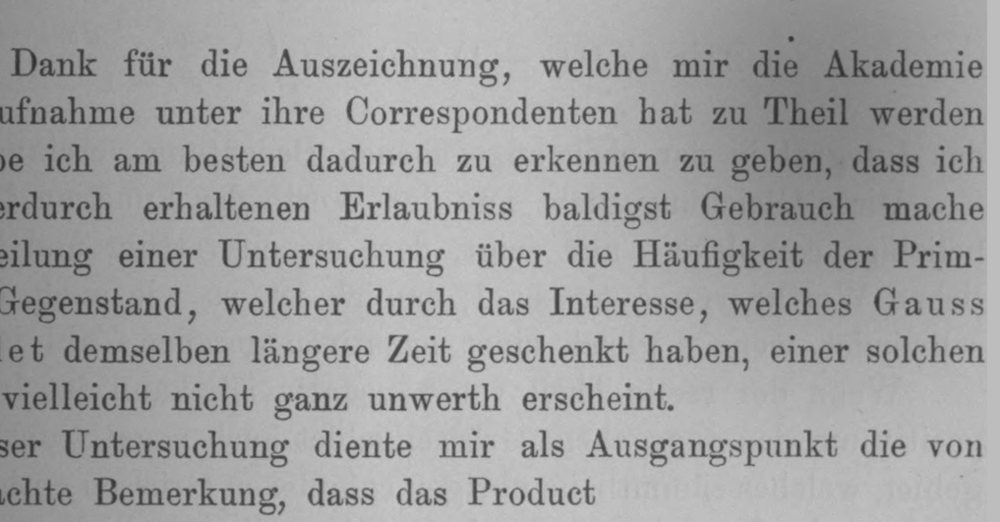
<figcaption>The grayscale input, with shadow and stain</figcaption>
</figure>
<figure markdown>
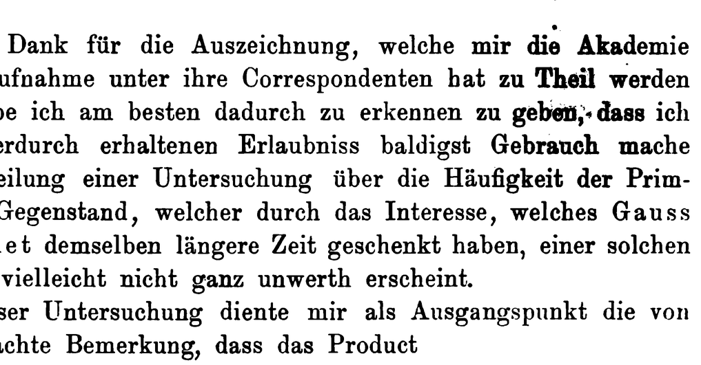
<figcaption><b>Otsu + Equalize illumination</b> (the default)</figcaption>
</figure>

<figure markdown>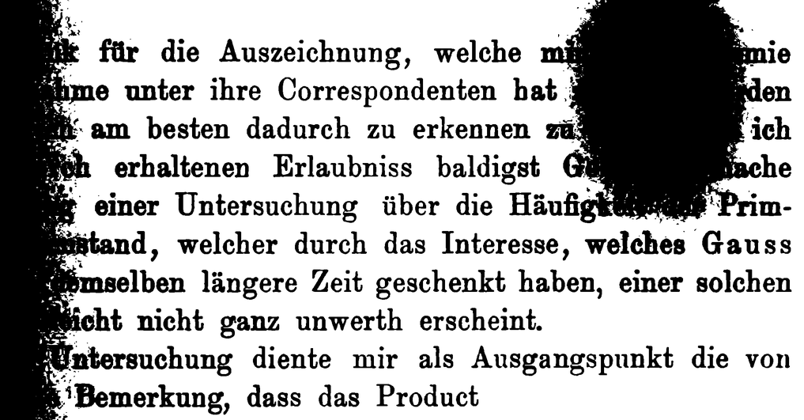<figcaption><b>Otsu</b> (without Equalize illumination)</figcaption></figure>
<figure markdown><figcaption><b>Sauvola</b></figcaption></figure>
<figure markdown>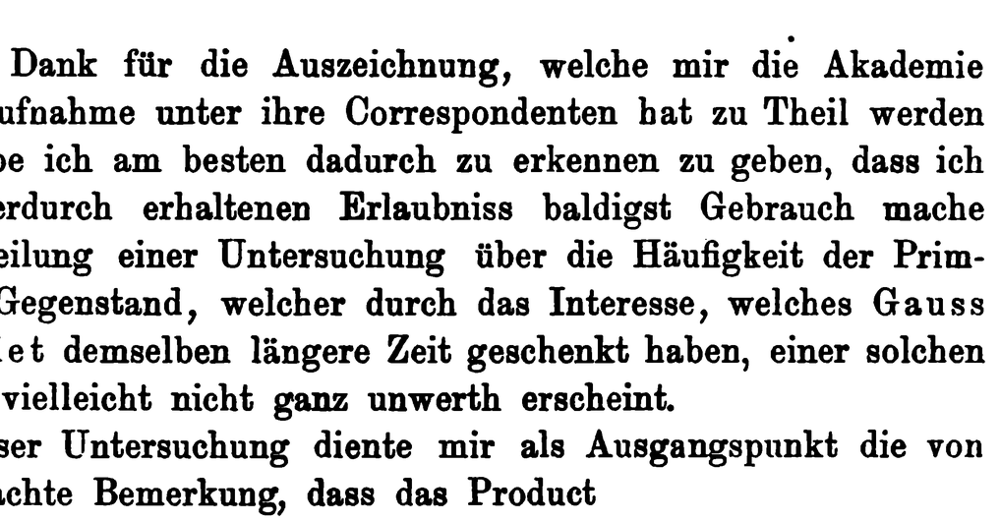<figcaption><b>Wolf</b></figcaption></figure>
<figure markdown>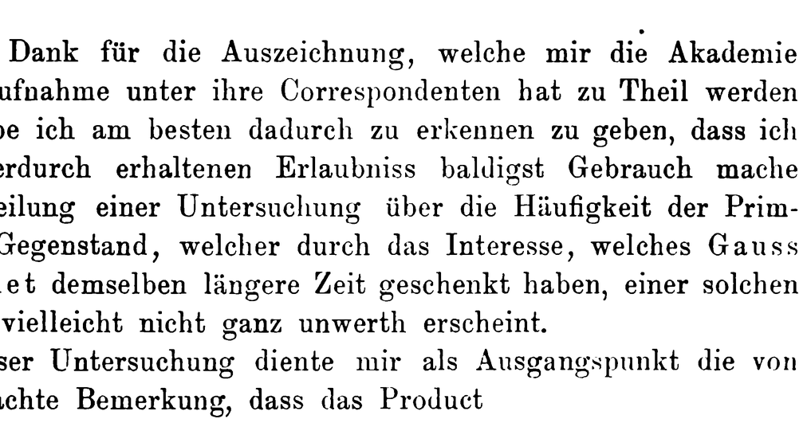<figcaption><b>Fox</b></figcaption></figure>
<figure markdown>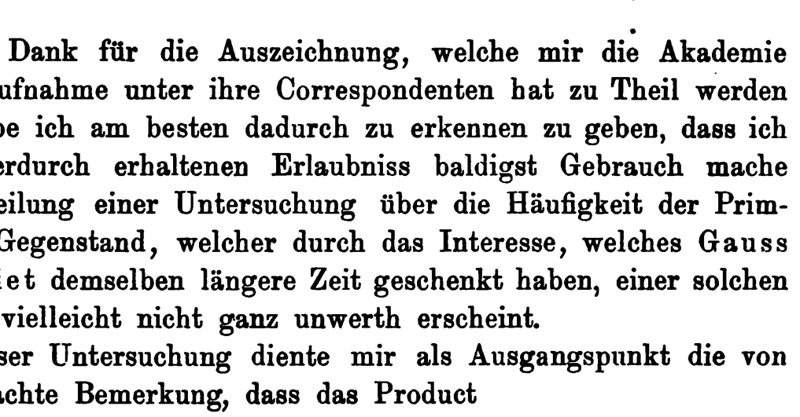<figcaption><b>Window</b></figcaption></figure>
<figure markdown>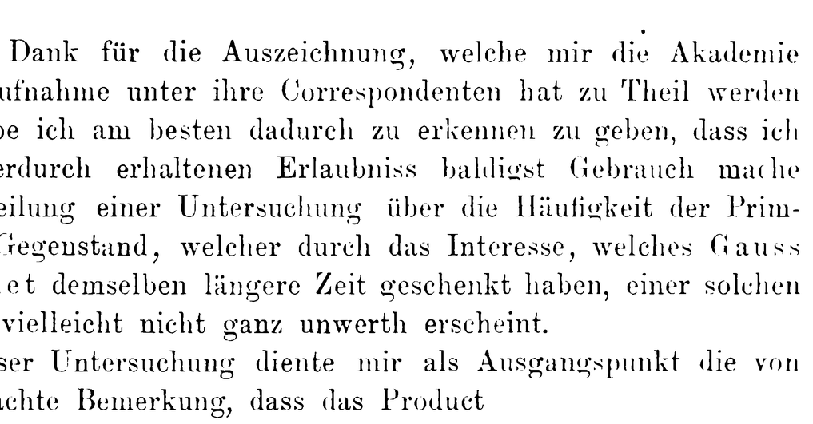<figcaption><b>Bradley</b></figcaption></figure>
<figure markdown>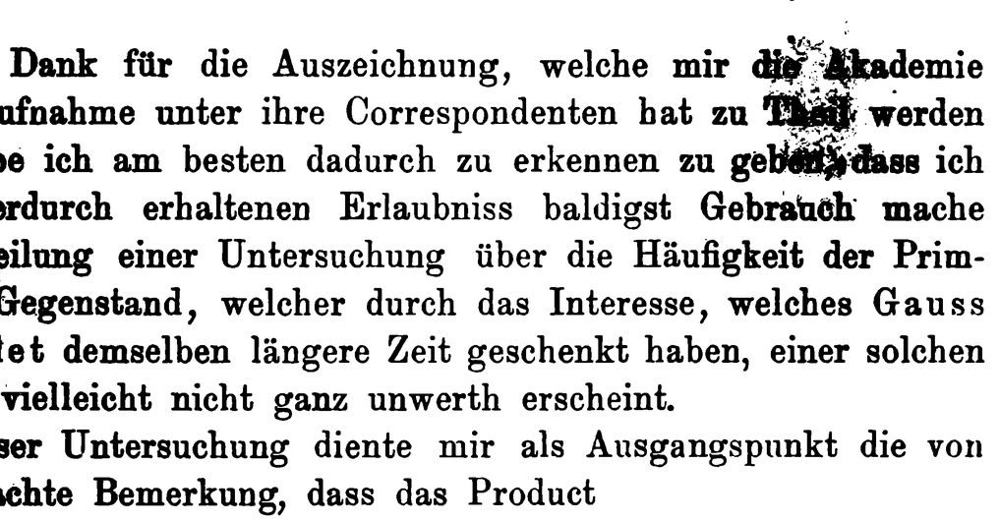<figcaption><b>Grad</b></figcaption></figure>
<figure markdown>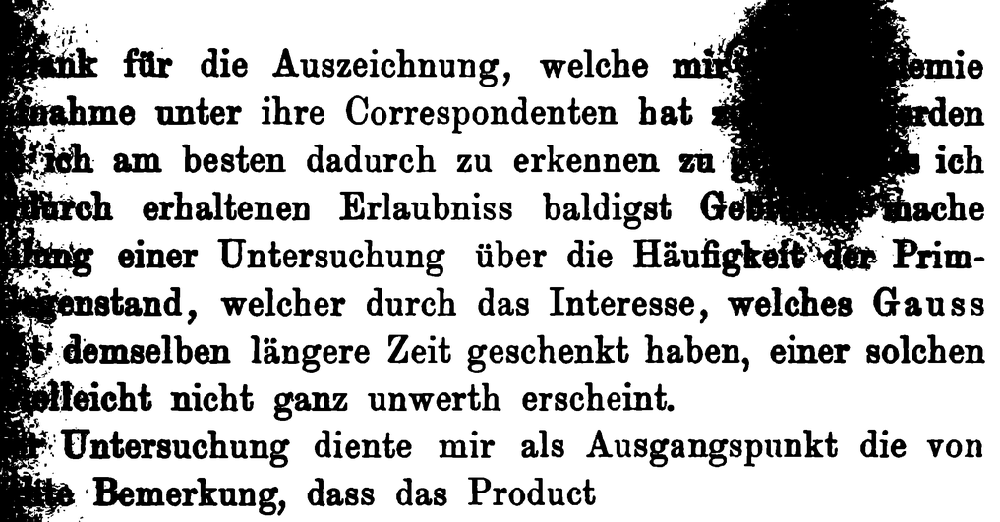<figcaption><b>EdgePlus</b></figcaption></figure>
<figure markdown>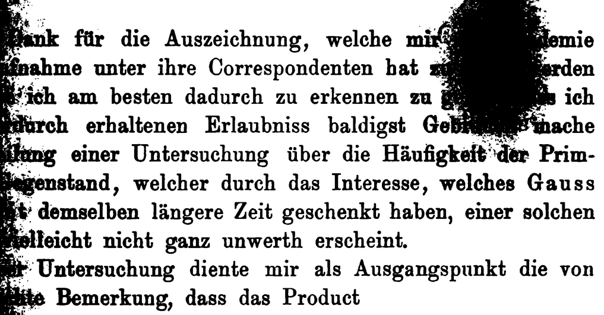<figcaption><b>BlurDiv</b></figcaption></figure>
<figure markdown>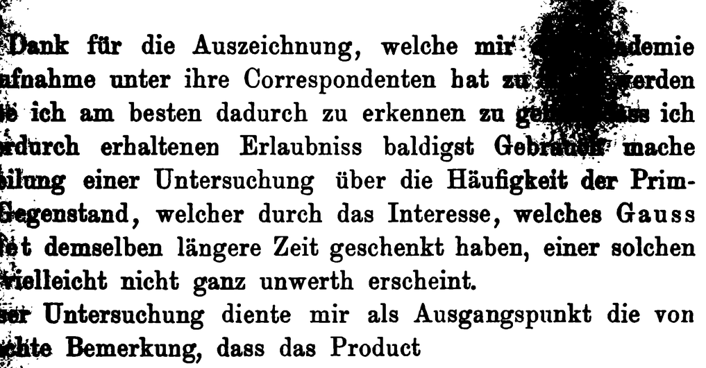<figcaption><b>EdgeDiv</b></figcaption></figure>
<figure markdown>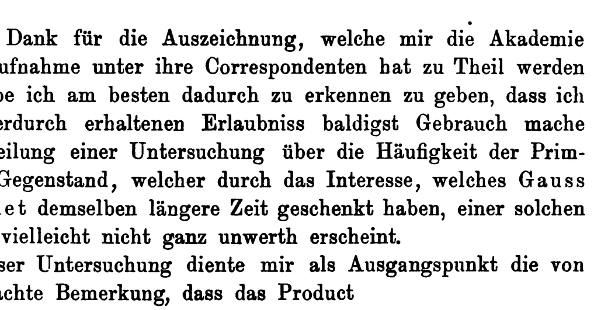<figcaption><b>Gatos</b></figcaption></figure>
<figure markdown>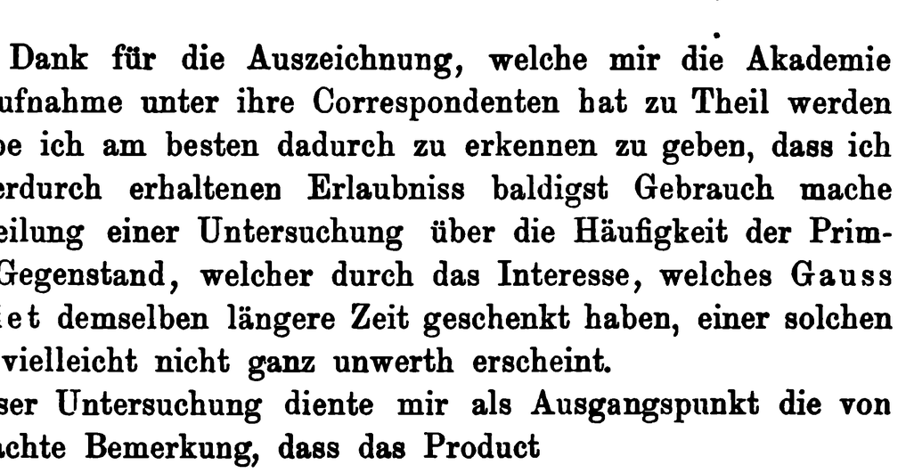<figcaption><b>Nick</b></figcaption></figure>
<figure markdown><figcaption><b>Singh</b></figcaption></figure>
<figure markdown>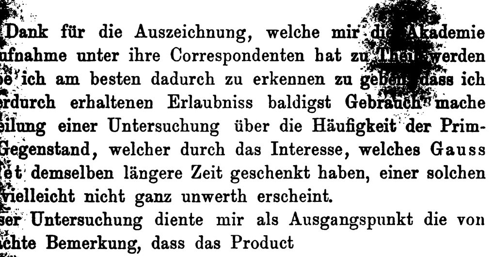<figcaption><b>Robust</b></figcaption></figure>
<figure markdown>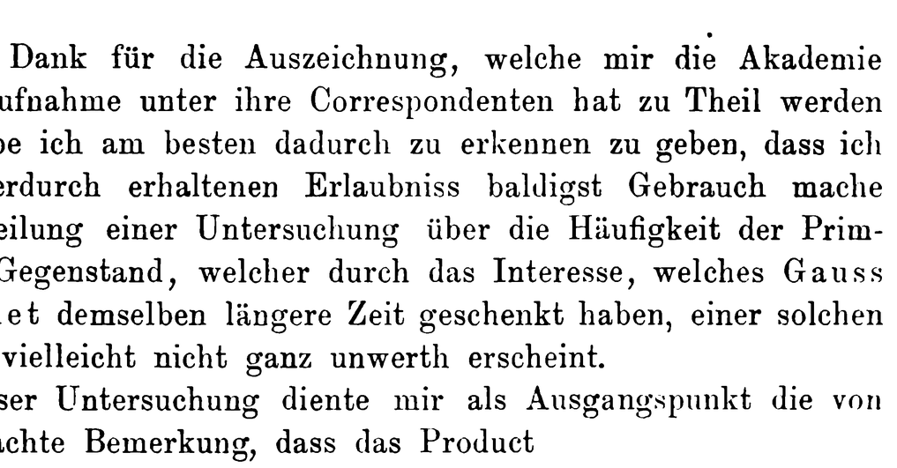<figcaption><b>MultiScale</b></figcaption></figure>

What this example shows:

- A global threshold alone (**Otsu**) fails on uneven paper. Together with **Equalize
  illumination**, which evens out the paper first, it handles even this strong shadow.
- Most **local methods** cope with the shadow and the stain on their own. They differ
  mainly in **stroke weight**: Wolf, Window, Nick and Grad give bold letters; Sauvola,
  Fox, Singh and MultiScale thin ones; Bradley very thin ones.
- **EdgePlus, BlurDiv and EdgeDiv** prepare the image and then use one global
  threshold. With their default strength, that is not enough for a shadow this strong;
  they are meant for moderate unevenness.
- **Grad** and **Robust** keep the letters inside the stain readable, but leave some
  specks there.

This is one page with one kind of damage. On your own pages the ranking can differ,
so try two or three methods on a typical page.

## Which method to try first

| Situation | Try |
|---|---|
| Clean print, even lighting | **Otsu** (with *Equalize illumination*, the default) |
| General printed text | **Sauvola**, **Wolf** |
| Shadow at the spine, uneven lighting | **Otsu** + *Equalize illumination*, **Wolf**, **Gatos**, **Robust** |
| Yellowed, stained paper | **Gatos**, **BlurDiv**, *Even out background* + **Otsu** |
| Faint or thin print on old paper | **Nick**, **Wolf** |
| Letters come out too thin | a bold method (**Wolf**, **Window**, **Nick**) or a positive **Delta** |
| Letters come out too bold, counters filled | a thin method (**Sauvola**, **Singh**) or a negative **Delta** |
| Very different text sizes on one page | **MultiScale**, **Window** |

## The methods in detail

### Otsu (global)

Looks at the histogram of the whole page: how many pixels there are of each gray value.
On a text page it has two humps, one for the ink and one for the paper. Otsu picks the
threshold that separates them best, so that each group is as uniform as possible.

- **Strengths:** fast, no window, no parameters but *Delta*; very clean result on even
  pages; no noise on empty paper.
- **Weaknesses:** one threshold for everything. Without *Equalize illumination*,
  shadows and stains turn black.
- **Settings:** *Delta*.

### Sauvola (local)

The classic local method for documents (Sauvola and Pietikäinen, 2000). The threshold
of each pixel is the mean brightness of its window, lowered in proportion to how little
contrast the window has. On empty paper (little contrast) the threshold sinks well below
the paper, so the paper stays clean.

- **Strengths:** a good general choice for printed text; little noise on the paper.
- **Weaknesses:** thin strokes; faint print on dark paper can break up.
- **Settings:** *Window size*, *Coef* (strength, default 0.34), *Delta*.

### Wolf (local)

A variant of Sauvola (Wolf, Jolion and Chassaing, 2002) for low contrast. It normalizes
the contrast of each window by the highest contrast of the page and takes the darkest
gray value of the page into account. Pages with weak overall contrast are therefore
handled better.

- **Strengths:** robust with low contrast and uneven lighting; bold, well-filled letters.
- **Weaknesses:** letters can become a little heavy; dirt can become dark specks.
- **Settings:** *Window size*, *Coef* (default 0.3), *Delta*.

### Fox (local)

Wolf's threshold combined with the contrast measure of Singh. It behaves like Wolf but
gives thinner strokes.

- **Settings:** *Window size*, *Coef* (default 0.3), *Delta*.

### Window (local)

After Bataineh, Abdullah and Omar (2011): a local threshold with windows that adapt to
the content, using the contrast of the window and of the whole page.

- **Strengths:** bold, solid letters, also with uneven lighting; good with text of
  different sizes.
- **Settings:** *Window size*, *Coef* (default 0.3), *Delta*.

### Bradley (local)

After Bradley and Roth (2005): compares each pixel with the mean of its surroundings. A
pixel becomes black if it is a certain percentage darker than that mean. Simple and very
fast.

- **Strengths:** speed; follows any change in lighting.
- **Weaknesses:** with the default values, letters become very thin and faint strokes
  can break; a positive *Delta* helps.
- **Settings:** *Window size*, *Coef* (default 0.34), *Delta*.

### Grad (local/global)

Mixes two thresholds. The local part is the mean of the window. The global part is the
average gray value of the page **weighted by how much each pixel differs from its
surroundings**, that is, the gray value at the edges of the letters. *Coef* sets the
share of the local part.

- **Strengths:** bold letters; letters inside stains stay readable.
- **Weaknesses:** can leave specks in stains and dark areas.
- **Settings:** *Window size*, *Coef* (default 0.3), *Delta*.

### EdgePlus, BlurDiv, EdgeDiv (prefilter + global)

These three first change the image and then use Otsu's global threshold:

- **EdgePlus** multiplies each pixel by how much it differs from a blurred copy of the
  page. Edges of letters become stronger against their surroundings.
- **BlurDiv** divides each pixel by a blurred copy of the page. Since the blurred copy
  is mostly the paper, the paper becomes even.
- **EdgeDiv** does both.

*Coef* sets how strongly the prefilter acts (default 0.34).

- **Strengths:** sharp, well-defined letters on moderately uneven pages.
- **Weaknesses:** the final threshold is global, so very strong shadows still turn black.

### Gatos (local, background estimation)

After Gatos, Pratikakis and Perantonis (2006). Works in several stages:

1. a Wiener filter removes noise,
2. a first rough binarization finds the likely text,
3. the **paper** under the text is estimated by filling in from the surrounding paper,
4. a pixel becomes black if it is clearly darker than the estimated paper at that place.

- **Strengths:** yellowed, stained or unevenly lit pages; clean paper.
- **Weaknesses:** slower than the simple methods.
- **Settings:** *Window size*, *Coef* (default 0.2), *Delta*.

### Nick (local)

After Khurshid and others (2009), a variant of Niblack's method. Niblack's threshold
(mean minus a multiple of the standard deviation) produces a lot of noise on empty
paper; Nick shifts it so that empty paper stays clean.

- **Strengths:** faint print on old documents; bold letters.
- **Settings:** *Window size*, *Coef* (default 0.1), *Delta*.

### Singh (local)

After Singh and others (2012): a local threshold from the mean and the local contrast
(how far a pixel differs from the mean), computed very quickly with integral images.

- **Strengths:** fast; clean, thin letters.
- **Settings:** *Window size*, *Coef* (default 0.3), *Delta*.

### Robust (local)

Transforms the image so that dark letters stand out against a brighter surround, hardly
affected by the absolute brightness, and then splits the result into two classes.
Shadows, for example near the spine, have little effect.

- **Strengths:** shadows and dark regions; letters inside stains stay readable.
- **Weaknesses:** can leave specks in stains.
- **Settings:** *Window size* (default 40), *Coef* (default 0.2), *Delta*.

### MultiScale (local)

Computes thresholds with several window sizes and combines them. Small windows follow
small text and fine details, large windows keep large letters and headings whole.

- **Strengths:** pages with text of very different sizes; clean result.
- **Weaknesses:** thin strokes.
- **Settings:** *Window size* (default 40), *Coef* (default 0.2), *Delta*.

## Settings that work with every method

| Setting | Use it when |
|---|---|
| **Delta** | Letters are too thin (positive values) or too bold (negative values). Small steps make a visible difference. |
| **Bounds** | Some gray values must always be black or white, whatever the method computes, e.g. lower bound 60 so that nothing that dark becomes white. |
| **Colored** | Colored text should become black (positive), or colored stamps and highlighter should vanish (negative). |
| **Equalize illumination** | Uneven lighting; essential with Otsu and the prefilter methods. |
| **Savitzky-Golay smoothing** | Letter edges look jagged. On by default. |
| **Morphological smoothing** | Single pixels stick out of the letters. On by default. |

Each method keeps its own *Delta*, *Coef* and *Window size*, so switching to another
method and back doesn't lose your values.

!!! tip "Combine filters and methods"
    The [enhancement filters](enhancement.md) run before the binarization. *Even out
    background* or *Equalize illumination* followed by a simple method is often better
    than a complex method alone.
