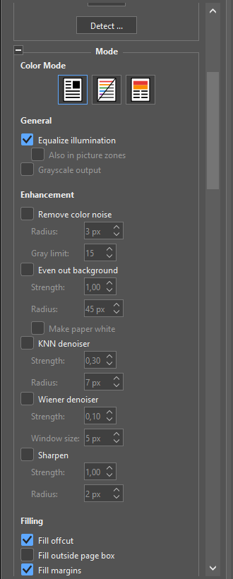

# Enhancement Filters

The filters under *Output > Mode > Enhancement* improve the scan **before** it is
converted to black and white or stored in color. They run in this order:

```
Remove color noise → Even out background → KNN denoiser → Wiener denoiser → Sharpen
```

All of them are off by default. Turn on only what a page needs: each filter costs time,
and a filter that isn't needed can make a page worse.

{ .panel }

## Remove color noise

**Problem:** color scans of gray or white paper often show colored speckles: single red,
green and blue pixels from the scanner's sensor. They make color files larger and can
make the color mode detection think the page is colored.

**How it works:** the image is split into brightness and color, as JPEG does. Only the
color is blurred, so single colored pixels take the color of their surroundings. Colors
weaker than the **Gray limit** become neutral gray. The brightness is not touched, so
the text stays sharp, and strong colors of pictures or colored text are kept.

| Setting | Meaning |
|---|---|
| **Radius** | How far the colors are smoothed. |
| **Gray limit** | Colors weaker than this become neutral gray. 0 only smooths. |

## Even out background

**Problem:** stains, uneven yellowing and shadows make the paper darker in some places.
A binarization method then has to tell a dark spot of paper from a letter.

**How it works:** the filter estimates the paper with a large median filter: in a window
much larger than the letters, the median is the paper's brightness, as letters cover only
a small part of it. It then subtracts this estimate, so the whole paper takes the
brightness of its brightest part.

| Setting | Meaning |
|---|---|
| **Strength** | How far the background is evened out, from 0.01 to 1. |
| **Radius** | The size of the area used to estimate the background. It must be clearly larger than the letters; too small, and thick letters are taken for background and get lighter. |
| **Make paper white** | Evens out each color channel on its own, which also takes the paper to white and removes a color cast such as yellowing. The colors of pictures shift as well. |

Pictures are flattened, too, so this filter is best for text pages.

!!! tip "Even out background or Equalize illumination?"
    Both even out uneven paper. *Equalize illumination* (under *General*) is the classic
    ScanTailor method and on by default. *Even out background* is an extra filter for
    stronger damage such as stains and yellowing, and with *Make paper white* it also
    works in color mode.

## KNN denoiser

**Problem:** grainy scans, for example from a camera or a cheap scanner. Grain makes the
edges of letters rough and leaves specks after binarization.

**How it works:** each pixel is averaged with the means of growing square windows around
it. Windows whose mean is close to the pixel count much, windows whose mean is very
different count little. A window reaching across the edge of a letter has a very
different mean, so edges are hardly blurred while flat areas become smooth.

| Setting | Meaning |
|---|---|
| **Strength** | From 0 (off) to 1. |
| **Radius** | The size of the neighborhood that is averaged. |

## Wiener denoiser

**How it works:** the classic Wiener filter. It estimates, for each pixel, how much of
the local variation is noise and how much is image, and smooths accordingly: strongly in
flat areas, little at edges. It acts more gently and more locally than the KNN denoiser.

| Setting | Meaning |
|---|---|
| **Strength** | From 0.01 to 1. |
| **Window size** | The neighborhood that is looked at. |

## Sharpen

**Problem:** slightly blurred scans, for example from a camera that was not quite in
focus.

**How it works:** an **unsharp mask**. The image is blurred, and the difference between
the image and its blurred copy (the fine detail) is added once more. Edges become
steeper.

| Setting | Meaning |
|---|---|
| **Strength** | How strongly the edges are sharpened, from 0.1 to 3. |
| **Radius** | The size of the details that are sharpened; larger values also sharpen coarser details. |

Sharpening also sharpens noise. If a scan is both grainy and blurred, use a denoiser
too; since sharpening runs last, it then works on the cleaned image.

## In color

In color and grayscale mode, the denoisers and sharpening work on the brightness, so the
colors are not shifted.
