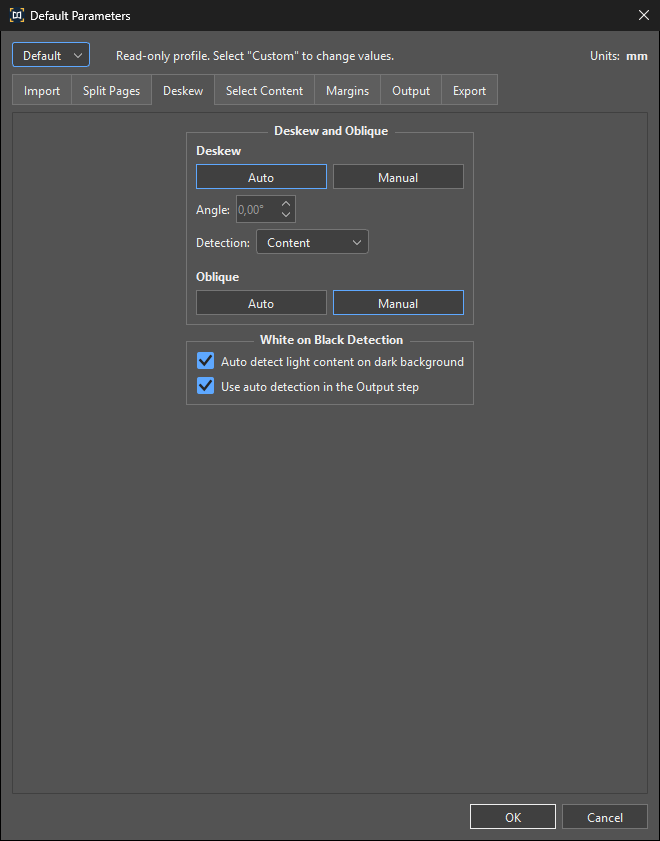

# Default Parameters

*Settings > Default Parameters ...* sets the values that **new projects** and **new
pages** start with. Saved under a name, they become a **profile**, for example one for
text books and one for art books.

{ .shot width="420" }

## Profiles

The list at the top left chooses the profile:

| Profile | Meaning |
|---|---|
| **Default** | The standard settings: automatic detection in every step, black and white output with Otsu and *Equalize illumination*. Read-only. |
| **Minimal** | Does as little as possible: no deskewing, no splitting, no content detection, no margins, color / grayscale output without filling the margins. Useful for photos or for pages that are already prepared. Read-only. |
| **Custom** | Your own changes. Choose it to edit values. |
| your saved profiles | Saved with **Save**, removed with **Delete**. |

The read-only profiles show their values, but you can't change them; choose *Custom*
for that. **Save** stores the current values under a name.

## Tabs

Each tab is laid out like the options panel of its step, so the settings look the same
in both places:

| Tab | Contains |
|---|---|
| **Import** | Rotation |
| **Split Pages** | Page type, split line method, page order |
| **Deskew** | Deskew and oblique, white on black detection |
| **Select Content** | Page box and content box with their detection settings |
| **Margins** | Margins, output size, alignment |
| **Output** | Resolution, color mode, filters, threshold, color mode detection, TIFF compression, ... |
| **Export** | Formats, text recognition, PDF compression |

### White on Black Detection (tab Deskew)

| Option | Meaning |
|---|---|
| **Auto detect light content on dark background** | Detects pages with light content on a dark background, such as white text on black, and inverts them internally so that deskewing, content detection and the output work. The detection runs once per page during deskewing. |
| **Use auto detection in the Output step** | Also sets *Dark content on a light background* in the Output step according to the detection. |

**Units** (top right) is the unit of the length fields. It follows the
[Program Settings](program-settings.md); a profile saved in pixels stays in pixels.

## Profiles and open projects

Each project keeps its own copy of the start values. Changing the profile therefore
doesn't change an open project. After **OK**, ScanTailor OCR asks whether the new values
should also be used for the open project; pages added to it later then start with them.

The settings of the whole project (compression, export formats, OCR languages, color
mode detection, white on black detection) are taken from the profile when a project is
created, and are stored in the project from then on.

## Profiles on the command line

The command line tool takes a profile with `--profile <name>` or a profile file with
`--profile <file.stp>`. See [Command Line Tool](command-line.md).
