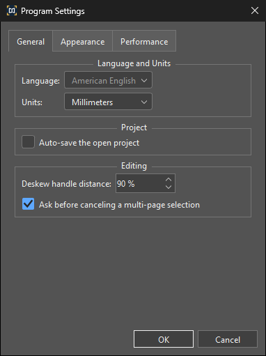

# Program Settings

*Settings > Program Settings ...* holds the settings of the program itself. They apply
to all projects.

{ .shot width="300" }

## General

| Setting | Meaning |
|---|---|
| **Language** | English or German. |
| **Units** | The unit of the length fields (pixels, millimeters, centimeters, inches), for example in *Margins* and in the *Default Parameters*, and of the mouse position and page size in the status bar. |
| **Auto-save the open project** | Saves the project without asking one minute after you worked on it. A new project is auto-saved only after it has been saved once. |
| **Deskew handle distance** | How far the drag handles of *Deskew* are placed from the image center. Smaller values move them away from the edge of the view, but make the angle react more strongly to the mouse. |
| **Ask before canceling a multi-page selection** | Asks before a click would drop a selection of several pages. |

## Appearance

| Setting | Meaning |
|---|---|
| **Color scheme** | *Dark*, *Light* or *System*. |
| **Accent color** | The color of checked buttons, focused fields, the keyboard focus frame, selected thumbnails and the progress bar. Not used by *System*, which takes the colors of the system. |
| **Display size** | The width of a thumbnail in the list (default 250 px). |
| **Image resolution** | The pixel size of the image a thumbnail is drawn from (default 200 px). Higher values are sharper, but take more memory and time. |
| **Single column thumbnail display** | Thumbnails in one column. |
| **Highlight the thumbnails of pages with high deviation** | Marks pages whose skew angle, content or margins deviate strongly from the others. *Multiplier*: a higher value means lower sensitivity. *Minimum*: the minimum deviation to be highlighted. |

## Performance

| Setting | Meaning |
|---|---|
| **Processor threads** | The maximum number of processor threads ScanTailor OCR uses at the same time: for the batch processing, the PDF export, the image filters and JPEG 2000. Fewer threads leave room for other programs, more threads finish sooner. Default: all threads but two. |
| **Accelerate user interface with OpenGL** | Draws the page view with the graphics card. |

!!! note "Restart"
    Language, color scheme and accent color take full effect only after a restart. After
    **OK**, ScanTailor OCR offers to restart right away and reopens the project at the
    step it was at.
