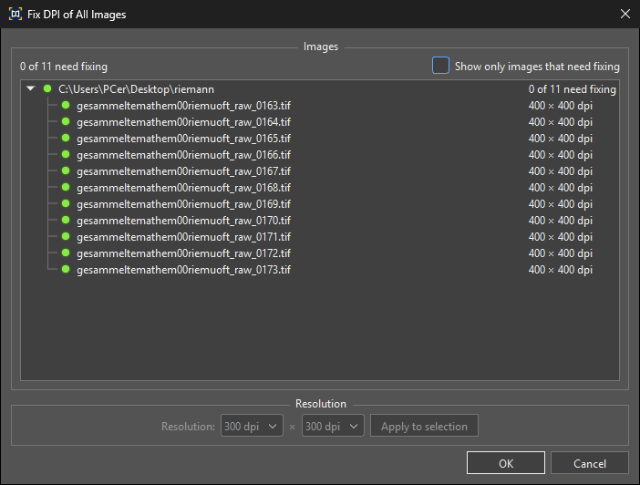

# Tools Menu

## Fix DPI of All Images

ScanTailor OCR needs the resolution (DPI) of every scan to convert between pixels and
millimeters. *Tools > Fix DPI of All Images ...* shows the resolution of all images of
the project and lets you correct it. It also opens by itself when a new project has
images without a usable resolution.

{ .shot width="460" }

The images are shown in a tree of folders, each with a traffic light:

| Icon | Meaning |
|---|---|
| Green | The resolution is fine. |
| Yellow | The resolution is implausible: too large and most likely wrong, or so small that the results won't be good. |
| Red | The resolution is missing. |

- **Show only images that need fixing** hides the green ones.
- Select images (++ctrl++ and ++shift++ work), enter the **Resolution** (horizontal ×
  vertical) and click **Apply to selection**.
- **OK** takes over the resolutions of all images.

!!! tip "Finding the right DPI"
    If you don't know the resolution, measure: a page of 210 mm (A4 width) that is 2480
    pixels wide was scanned at 2480 ÷ 210 × 25.4 ≈ 300 DPI. The status bar shows the size
    of the image in pixels and in the chosen unit.

## Relink

When the images, the output folder or the project file have been moved, the project
can't find them anymore. *Tools > Relink ...* opens the relinking window; it also opens
by itself when a project with missing files is opened.

- **Output Folder**: the path where the project looks for its output. Only the path
  changes; no files are moved.
- **Images**: a tree of the image folders, each with "n of m missing". **Show missing
  only** hides the complete ones. Select a folder or file and type its new path, or use
  **Locate ...**.

Changes apply at once. A relinking that would make several images use the same file is
refused. If the output folder is missing, it is created again once all images are in
place.
