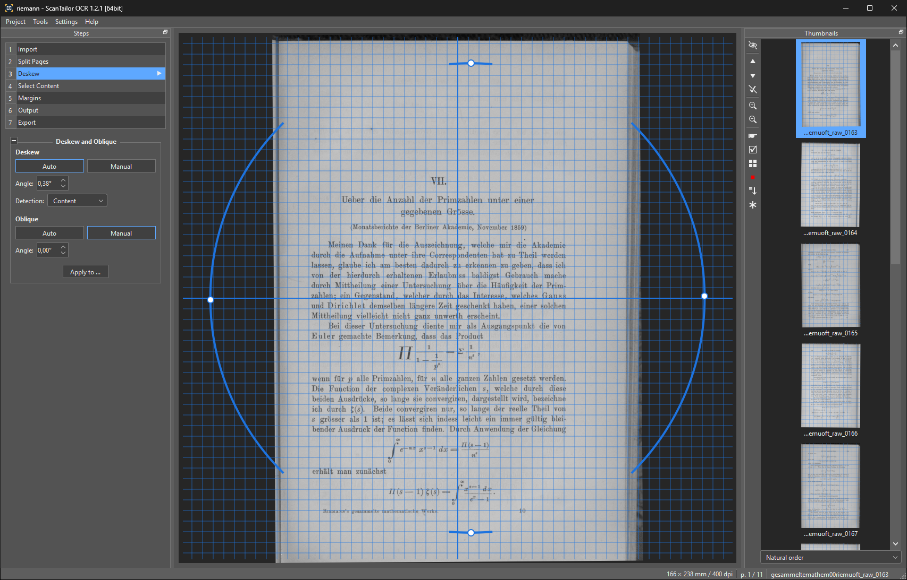

# 3 Deskew

Pages are rarely placed perfectly straight on the scanner. This step turns each page so
that the lines of text are horizontal, and can also correct a shear (oblique) distortion.

{ .shot }

## Deskew

**Auto** measures the rotation angle of each page. **Manual** keeps the angle in the
**Angle** field (up to ±45°).

**Detection** chooses what *Auto* measures:

| Method | How it works | Best for |
|---|---|---|
| **Content** | Finds the angle at which the lines of text run most exactly horizontal. | Almost all pages |
| **Top page edge** | Takes the angle of the top edge of the paper. | Book scans with a dark background around the page, pages with little text |

To correct the angle by hand:

- drag one of the round **handles** on the circle, or
- hold ++ctrl++ and turn the mouse wheel; ++ctrl+shift++ + wheel turns in finer steps.

The grid helps to judge whether the lines are straight. How far the handles sit from
the center is set under *Deskew handle distance* in the
[Program Settings](../reference/program-settings.md).

## Oblique

A sheared page has its lines horizontal but its columns slanted, like a parallelogram.
This happens with some book scanners and with pages that slipped during scanning.

**Auto** measures the shear from the **straight edges of the text**: the starts and ends
of the lines of a column. It only corrects a page when at least two such edges agree.
Pages with ragged text in one column, centered text or only a few lines keep 0°.

**Manual** keeps the angle in the **Angle** field (up to ±5°). The flat handles at the
top and bottom of the circle adjust it with the mouse.

**Apply to ...** copies the rotation angle (with *Auto*: the detection method; each page
is then measured on its own) and the oblique correction to other pages.

## White text on black

During deskewing, ScanTailor OCR also checks whether a page has light content on a dark
background, such as white text on black. Such pages are inverted internally so that the
detection in this and the later steps works. This can be turned off in the
[Default Parameters](../reference/default-parameters.md), tab *Deskew*.
