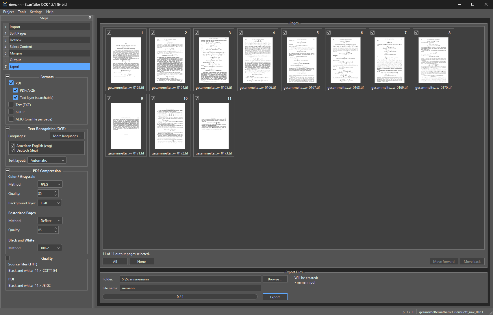

# 7 Export

The last step writes the output files of the project into a PDF and, if you like, into
text formats. It doesn't process pages itself: it uses the files the *Output* step has
written. Pages not output yet are grayed out.

{ .shot }

## Pages

The page area shows all pages in project order. Only **ticked** pages are exported;
their number shows their position in the PDF.

- **All** / **None** tick or untick all pages.
- Change the order with drag and drop, or with **Move forward** / **Move back**.
- A warning sign above a thumbnail marks a page with a quality problem, an information
  sign a note. The tooltip of a page tells its color mode, its compression and the
  warning.

Ticks and order are kept while the project is open, but are not saved with it.

!!! warning "Changed pages"
    If pages were changed after their output was written, the export would show the
    state of the last output. **Output missing and changed pages** processes them first.

## Formats

Any combination, also without a PDF:

| Format | Creates |
|---|---|
| **PDF** | One PDF file with the pages as images. |
| ↳ **PDF/A-2b** | The PDF follows the ISO standard for long-term archiving, with a color profile and metadata. Adobe Acrobat opens such files read-only at first; editing has to be enabled there. |
| ↳ **Text layer (searchable)** | Puts the recognized text invisibly over the pages, so it can be searched, selected and copied. |
| **Text (TXT)** | One text file with the text of all pages, separated by a page break (form feed). |
| **hOCR** | One HTML file with the text and the position of each word. |
| **ALTO (one file per page)** | A folder with one XML file per page, with the text and the position of each word. Libraries and archives use this format. |

The text of each page is recognized once, however many formats need it, and not at all
if none does.

## Text Recognition (OCR)

This panel is active when a chosen format needs text.

- **Languages**: tick the languages of the text. Several can be ticked, for example
  German and English for a German book with English quotations. Each extra language
  makes the recognition a little slower.
- **More languages ...** downloads further languages from the internet (see below).
- **Text layout**: how the text is arranged on the pages. It decides the order in which
  the text is read, for searching and copying; the look of the PDF doesn't change.

| Text layout | Use it for |
|---|---|
| **Automatic** | Detects columns, pictures and captions. Usually right. |
| **Single column** | Copied text comes out in the wrong order, e.g. with indented lines or tables. |
| **Single block of text** | Pages with one short text, such as a label or a note. |

### Downloading languages

**More languages ...** shows the languages of the *tessdata_best* collection of the
Tesseract project, which give the best recognition. Search for a language (e.g.
"Deutsch" or "fra"), tick it and click **Download**. *Scripts* are models for all
languages written in one script, such as Latin, Cyrillic or Fraktur.

Languages a project uses but that are missing on this computer are shown with a warning
sign. The export offers to download them first.

More about the recognition in [Text Recognition](../methods/ocr.md).

## PDF Compression

How the pages are stored in the PDF, separately for each kind of page. The settings
apply to the whole project.

| Kind of page | Methods | Default and recommendation |
|---|---|---|
| **Color / Grayscale** (and the pictures of split pages) | JPEG, JPEG 2000, Deflate, None | JPEG. *Quality* sets the trade-off between size and quality. *Background layer* sets the resolution of the pictures of split pages (full, half, one third). |
| **Posterized Pages** | Deflate, JPEG, JPEG 2000, None | Deflate: lossless and small for few colors. |
| **Black and White** (and the text of split pages) | JBIG2, CCITT G4, Deflate, None | JBIG2: lossless and the smallest. |

[Compression](../methods/compression.md) explains the methods and their trade-offs.

## Quality

Lists the compression of the ticked pages, both in the output folder (TIFF) and in the
PDF, and warns about combinations that lose quality without need:

- TIFF files stored with lossy compression (JPEG): the PDF can't undo these losses.
- Pages compressed with loss **twice** (JPEG in the TIFF and again in the PDF).
- Posterized pages that JPEG or JPEG 2000 would convert to full color.
- Mixed pages without split output, which make the PDF much larger.

## Export Files

| Field | Meaning |
|---|---|
| **Folder** | Where the files go. Default: the folder of the project file. |
| **File name** | Without extension; each format adds its own. |

Beside them, ScanTailor OCR lists the files that will be created, or what is wrong with
the folder or the name. Existing files are only replaced after one question that lists
them all.

**Export** starts. The pages are prepared in parallel, with a progress bar and a cancel
button. All files are written to temporary files first, so a canceled or failed export
never leaves a broken file or damages an existing one. Afterwards, the created files are
listed with their size, as links that open them.

While an export runs, the other steps and opening, creating or closing a project are
locked.
