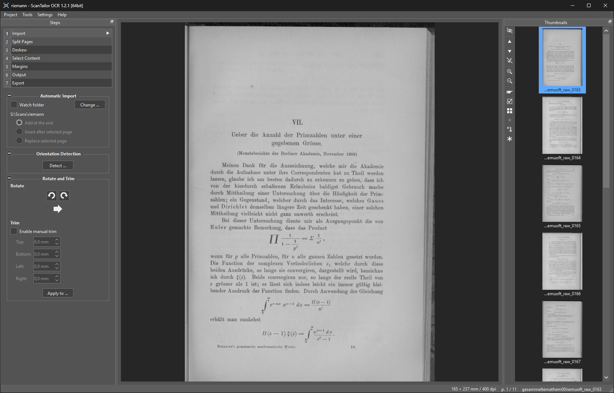

# 1 Import

The first step brings the scans upright, trims edges you never want to see, and can
import new scans while you are still scanning.

{ .shot }

## Rotate and Trim

### Rotate

The two buttons turn the scan a quarter turn counterclockwise or clockwise. The arrow
below them shows where the **top edge of the original image** points after the rotation.

Scanners often deliver every image turned the same way. Rotate the first page, then use
**Apply to ... > All pages**.

### Trim

With **Enable manual trim**, you can cut a strip off each side of the scan: *Top*,
*Bottom*, *Left* and *Right*. The values refer to the rotated view and use the unit of
the [Program Settings](../reference/program-settings.md).

Use it for things that are on every scan and should never be part of the page, such as
the edge of the scanner glass or a ruler. Trimmed areas are not looked at again in any
later step. In *Output*, **Fill offcut** paints them with the background color if the
page reaches into them.

**Apply to ...** copies the rotation, the trim, or both to other pages.

## Orientation Detection

**Detect ...** recognizes the text on the chosen pages and turns each page so that the
text is upright. It is useful when pages were fed into the scanner in different
directions.

- Pages whose orientation is **certain** are rotated.
- Pages whose orientation is **uncertain** (few words, pictures, formulas) are left as
  they are and listed in the summary.

With **Rotate uncertain pages like their neighbors or the majority**, uncertain pages
get the orientation of the pages around them, or else of most pages. This also handles
duplex scans where every second page comes out upside down. For this, all pages of the
project are analyzed, which takes longer; only the chosen pages are rotated.

## Automatic Import

The panel **Automatic Import** watches a folder and adds every new scan to the project
as soon as it is completely written. See
[Automatic import of new scans](../getting-started/projects.md#automatic-import-of-new-scans)
for the three ways to place new scans: *Add at the end*, *Insert after selected page* and
*Replace selected page*.

!!! tip "Scan and check at the same time"
    Point your scanning program to the input folder and turn on **Watch folder**. Each
    scan appears in ScanTailor OCR seconds later, and you can check it in the later steps
    right away. A bad scan is replaced with *Replace selected page* and a new scan.

Scans that arrive during batch processing or an export are added afterwards. Scans
without a resolution are added and counted; set their DPI with
*Tools > Fix DPI of All Images*.
