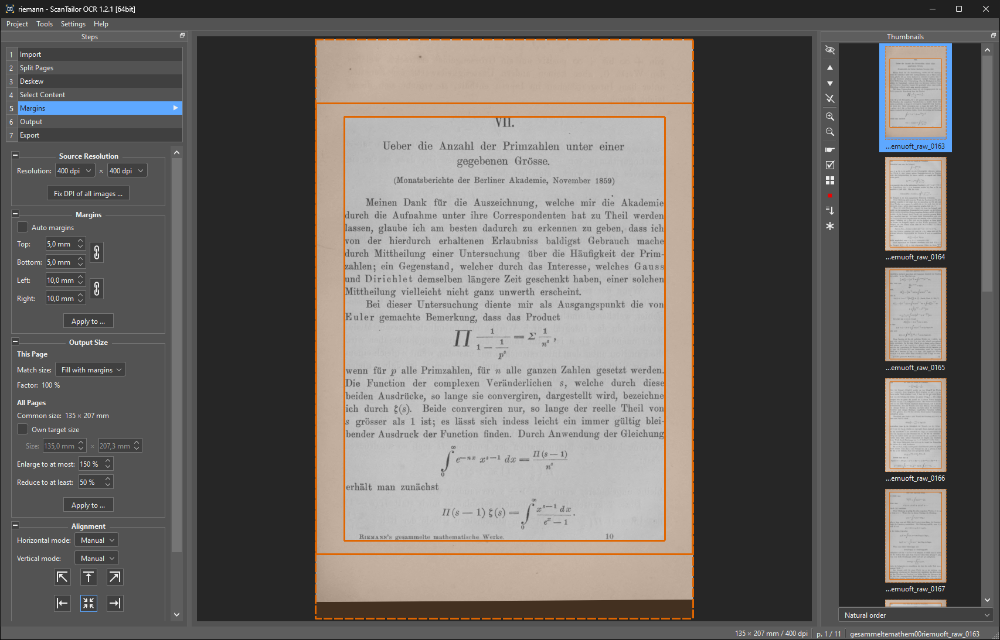

# 5 Margins

This step decides how large each output page is and where the content sits on it:
margins around the content box, a common size for all pages, and the alignment.

{ .shot }

In the page view, the **inner** rectangle is the content box, the **outer** one the
page with its margins.

## Source Resolution

The resolution of the scanned image (horizontal × vertical). Sizes and margins in
millimeters or inches depend on it, so a wrong value here gives wrong page sizes.
A change applies right away to the whole image, so to both pages of a split scan.
**Fix DPI of all images ...** opens the window with the resolution of all images, the
same as *Tools > Fix DPI of All Images*.

## Margins

**Top**, **Bottom**, **Left** and **Right** are the space between the content box and
the edge of the output page. The chain buttons link top and bottom, or left and right,
so that changing one changes the other.

**Auto margins** takes the margins from the scan itself: the distance between the content
box and the page box found in *Select Content*. Use it when the original layout of the
page should be kept.

You can also drag the solid lines in the page view.

## Output Size

Pages of a book usually come out of *Select Content* with slightly different sizes. The
output size makes them equal again.

### This Page

**Match size** decides how this page takes part:

| Option | What happens |
|---|---|
| **Off** | The page keeps its own size and doesn't count for the common size. Use it for fold-outs or plates of a different size. |
| **Fill with margins** | The page is brought to the output size by adding margins, placed as set under *Alignment*. The content keeps its size. |
| **Scale** | The content is enlarged or reduced to fit the output size, within the limits below. The margins keep their size. |

**Factor** shows how much the content of this page is enlarged or reduced.

### All Pages

These settings apply to the whole project.

| Setting | Meaning |
|---|---|
| **Common size** | The largest width and the largest height of all pages whose size is matched, margins included. |
| **Own target size** | Sets the output size by hand instead, for example to a paper format. Pages larger than this size are reduced. |
| **Enlarge to at most** | Pages set to *Scale* are enlarged to at most this percentage. |
| **Reduce to at least** | Pages larger than the output size are reduced to no less than this percentage; a page that would need more stays larger. |

!!! note
    The common size is only known once all pages have been through this step. That's why
    *Output* asks you to run the batch processing in *Select Content* or *Margins* first.

## Alignment

Where the content sits when the page is larger than content plus margins.

| Mode | Meaning |
|---|---|
| **Manual** | The nine buttons: top left, top, top right, left, center, right, bottom left, bottom, bottom right. |
| **Auto** | Like the original page, but snapped: if the content is clearly closer to one side, it is aligned to that side, otherwise centered. |
| **Original** | Keeps the position the content had on the original page. |

The horizontal and the vertical mode are set separately.

## Guides

For exact layouts you can place guides:

- **Right click** in the page view to add a horizontal or vertical guide, or to remove
  guides.
- ++ctrl+alt++ + drag moves a guide.
- ++shift++ or ++ctrl++ + drag on the content rectangle moves the content (++shift++
  only horizontally, ++ctrl++ only vertically, both freely).
- **Double-click** on the content attaches it to the nearest guide.
- The context menu can also show the **hard margins rectangle**.

**Apply to ...** exists separately for the margins, for *Match size* and for the
alignment.
