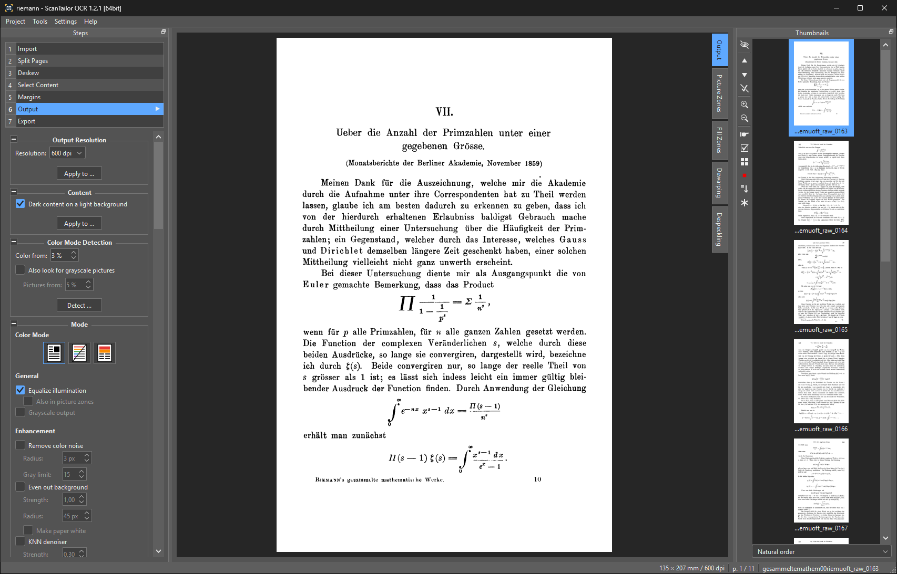
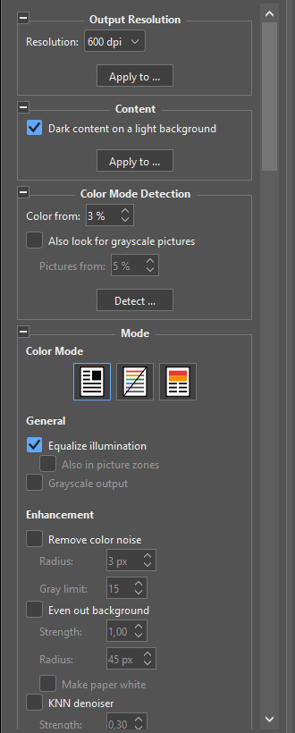
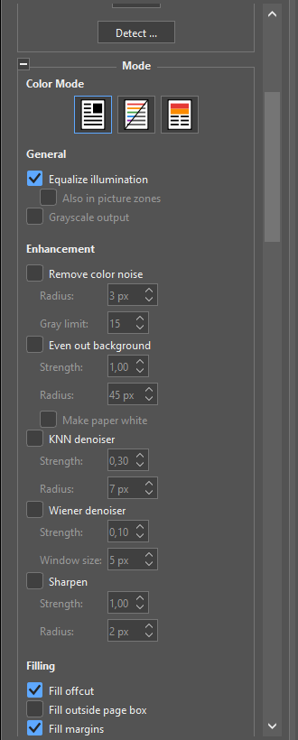
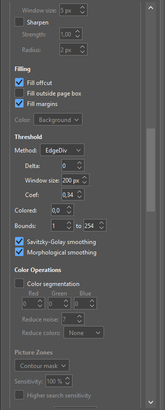
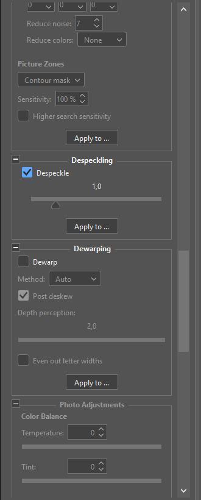
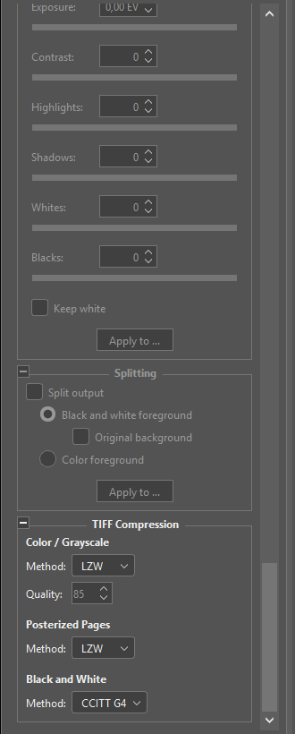

# 6 Output

This step creates the final page images. It decides whether a page becomes black and
white, color or mixed, cleans it up, straightens bent lines and writes the result as a
TIFF file into the output folder. The [Export](export.md) step later builds the PDF from
these files.

{ .shot }

The options panel is long. Its parts, from top to bottom:

[Output Resolution](#output-resolution) ·
[Content](#content) ·
[Color Mode Detection](#color-mode-detection) ·
[Mode](#mode) ·
[Despeckling](#despeckling) ·
[Dewarping](#dewarping) ·
[Photo Adjustments](#photo-adjustments) ·
[Splitting](#splitting) ·
[TIFF Compression](#tiff-compression)

## The tabs of the page view

The tabs at the right edge of the page view show different aspects of the page.
Switch with ++ctrl+1++ to ++ctrl+5++.

| Tab | Shows |
|---|---|
| **Output** | The page as it will be saved. |
| **Picture Zones** | The areas treated as pictures. Only in *Mixed* mode. You can draw and edit zones here. |
| **Fill Zones** | Areas you fill with a color of your choice, e.g. to remove a stamp or a library label. |
| **Dewarping** | The curves used to dewarp the page. With the method *Manual*, you place them yourself. |
| **Despeckling** | A preview of the specks that are removed. |

## Output Resolution

{ .panel }

The resolution of the output files, from 72 to 1200 DPI. The common choices 300, 400, 600
and 1200 DPI are in the list; other values can be typed in.

The output resolution can be higher than that of the scan. For black and white output,
600 DPI usually gives smoother letters than 300 DPI, even from a 300 DPI scan, because
the page is enlarged in grayscale before the conversion, so the edges of the letters
are placed between the original pixels.

## Content

**Dark content on a light background** is on for normal pages. Turn it off for pages
with light content on a dark background, such as white text on black: the page is then
inverted for the processing.

It is set automatically when the white on black detection is turned on in the
[Default Parameters](../reference/default-parameters.md). A change made here by hand
always takes precedence.

## Color Mode Detection

**Detect ...** looks at the chosen pages and sets their color mode (black and white,
color / grayscale or mixed), without creating output files. Its settings apply to the
whole project:

| Setting | Meaning |
|---|---|
| **Color from** | A page counts as a color page only if at least this share of it is colored outside pictures. Colored headings, boxes and thumb index tabs below it are ignored. Colored pictures make the page *Mixed*. |
| **Also look for grayscale pictures** | Also looks for picture zones on pages detected as black and white. Finds light or small photos, but takes longer. |
| **Pictures from** | A black and white page becomes *Mixed* if its largest picture zone covers at least this share of the page. Lower it for small pictures, raise it if stamps or stains are taken for pictures. |

## Mode

{ .panel }

### Color Mode

The three picture buttons choose how the page is stored:

| Mode | Result | For |
|---|---|---|
| **Black and White** | Every pixel black or white. Smallest files, sharpest text. | Text and line drawings |
| **Color / Grayscale** | The whole page as an image. | Photos, color plates, pages where the paper tone matters |
| **Mixed** | Pictures in color or grayscale, the rest black and white. | Text pages with photos or illustrations |

[Color Modes](../methods/color-modes.md) explains when to use which.

### General

| Option | Meaning |
|---|---|
| **Equalize illumination** | Evens out uneven lighting, such as a shadow near the spine. In black and white and mixed mode it is done before the conversion to black and white, in color mode on the whole page. |
| **Also in picture zones** | Mixed mode only: also evens out the lighting in the pictures. |
| **Grayscale output** | Stores color scans in grayscale: the whole page in color / grayscale mode, pictures and colored text in mixed mode. Much smaller files. |

### Enhancement

Filters that improve the image before everything else. They run in the order shown.

| Filter | Does |
|---|---|
| **Remove color noise** | Turns weak colors, such as single red, green and blue pixels on gray paper, into neutral gray. |
| **Even out background** | Evens out stains, yellowing and shadows in the paper. *Make paper white* also removes a color cast. |
| **KNN denoiser** | Reduces noise while keeping the edges of the letters sharp. |
| **Wiener denoiser** | Reduces noise. |
| **Sharpen** | Sharpens blurred edges. |

What each filter does and how its settings work is explained in
[Enhancement Filters](../methods/enhancement.md).

{ .panel }

### Filling

| Option | Meaning |
|---|---|
| **Fill offcut** | Fills what was cut off in *Import* or by the split line, such as part of the facing page. |
| **Fill outside page box** | Fills the whole output page outside the page content with the background color, instead of following the shape of the offcut. |
| **Fill margins** | Fills everything outside the content box, so dirt and edges there disappear. |
| **Color** | *Background* (the paper color found on the page; white in mixed mode), *White* or *Black*. |

### Threshold

How a grayscale image becomes black and white: for every pixel, the method decides
whether it is darker than a **threshold** (black) or lighter (white).

| Setting | Meaning |
|---|---|
| **Method** | One of 15 binarization methods. Otsu uses one threshold for the whole page; all others adapt it to each area. |
| **Delta** | Shifts the threshold: positive values make the letters thicker and darker, negative values thinner and lighter. |
| **Window size** | The size of the neighborhood a local method looks at. |
| **Coef** | The strength of the method. Its tooltip names the default of each method. |
| **Colored** | Positive values darken colored pixels before the conversion, so colored text becomes black; negative values lighten them, so colored stamps or highlighter marks disappear. |
| **Bounds** | Pixels darker than the lower bound are always black, lighter than the upper bound always white. 1 and 254 leave the method alone. |
| **Savitzky-Golay smoothing** | Smooths the grayscale image before the conversion, for smoother letter edges. |
| **Morphological smoothing** | Smooths the edges of the black and white result: single pixels sticking out or missing are removed or filled. |

**Which method?** See [Binarization](../methods/binarization.md): it explains every
method and shows all of them on the same page.

### Color Operations

For black and white and mixed pages with **colored text** (red headings, blue ink):

| Setting | Meaning |
|---|---|
| **Color segmentation** | Splits the image into color segments and colors the black and white text with them. *Red*, *Green* and *Blue* make the segmenter more (negative) or less (positive) sensitive to a color. *Reduce noise* removes small color segments. |
| **Reduce colors** | *None*: each letter keeps its own average color. *Posterize*: fixed color levels. *K-means*: finds the colors that fit the page best. |
| **Colors** | With K-means: the number of colors (2 to 16). |
| **Fixed black** | With K-means: one of the colors is pure black, so black text stays black. |
| **Level**, **Normalize**, **Force black and white** | Settings of *Posterize*; see [Color Modes](../methods/color-modes.md#reducing-colors). |

In color / grayscale mode, *Posterize* reduces the colors of the whole page.

### Picture Zones

Mixed mode only: how pictures are found.

| Setting | Meaning |
|---|---|
| **Off** | No automatic pictures; only zones you draw. |
| **Contour mask** | Pictures follow their outlines. |
| **Rectangle** | Pictures are rectangles. **Sensitivity** trims the rectangles inward to the first row or column the picture fills to at least this share (100 %: no trimming). |
| **Higher search sensitivity** | Also finds pictures with weak contrast; text may then be taken for a picture, too. |

On the *Picture Zones* tab you can correct the result by drawing zones yourself. The
selection mode for new zones (polygon, lasso, rectangle) is a button in the status bar,
or press ++z++, ++x++ or ++c++. A right click on a zone opens its **Properties**:

- *Add to auto layer* / *Subtract from auto layer*: add to or cut out of the automatic
  picture zones,
- *Add to foreground* / *Add to background*: force an area to text or to picture,
- *Subtract from all layers*: remove an area from all zones.

## Despeckling

{ .panel }

**Despeckle** removes small specks, such as dust and dirt, from the black and white
result. The slider sets how strongly. The *Despeckling* tab shows what would be removed.

The despeckling judges specks by their size in millimeters and by their place relative
to the line of text, so dots on the i, umlauts, commas, hyphens and dot leaders are kept,
while dust and dirt at the page edges go. It can't be used in color / grayscale mode.

## Dewarping

**Dewarp** straightens bent lines of text, as near the spine of a thick book, and
corrects a trapezoid distortion. **Method**:

| Method | Works from |
|---|---|
| **Auto** | The curvature of the lines of text. |
| **Trapezoid** | Takes the lines as straight and corrects only a trapezoid distortion. For flat pages. |
| **Marginal** | The top and bottom edges of the page against a dark background. |
| **Manual** | Curves you place yourself on the *Dewarping* tab. |

| Option | Meaning |
|---|---|
| **Post deskew** | Straightens the page once more after dewarping (*Manual* and *Marginal* only). |
| **Depth perception** | How strongly the page is taken to curve away from the viewer; mostly changes how far the text near the spine is stretched. |
| **Even out letter widths** | Measures the width of the letters across the page and evens out letters that came out too narrow near the spine. Slower. |

If a page is left undewarped because too few lines of text were found, the panel says
so. Details in [Dewarping](../methods/dewarping.md).

## Photo Adjustments

{ .panel }

Sliders like in a photo editor, applied to the **pictures** after everything else:

- **Color Balance**: *Temperature* (warmer/yellower or cooler/bluer), *Tint* (magenta
  or green).
- **Tone**: *Exposure* (in stops), *Contrast*, *Highlights*, *Shadows*, *Whites*,
  *Blacks*.
- **Keep white**: color / grayscale mode only; pure white stays white, such as a
  background made white.

In color / grayscale mode they change the whole page, in mixed mode only the picture
zones; black and white text, picture detection and OCR are not affected. In black and
white mode they are not used.

## Splitting

Mixed mode only. **Split output** also saves the page as two files: the text in the
folder `foreground` and the pictures in the folder `background`, next to the output
files.

- **Black and white foreground**: the text is stored in black and white. With
  **Original background**, the paper around the text keeps its scanned look under
  crisp black text.
- **Color foreground**: the text keeps its colors.

The PDF export uses these layers to store mixed pages far more compactly: the text as a
sharp black and white mask over a small picture. See
[Compression](../methods/compression.md#mixed-pages).

## TIFF Compression

The compression of the TIFF files in the output folder, for the whole project, with one
setting per kind of page: *Color / Grayscale*, *Posterized Pages* and *Black and White*.
The PDF is compressed separately, so this doesn't change it; see
[Compression](../methods/compression.md#tiff-files-in-the-output-folder).

After a change, the output is created again: the current page right away, the other
pages during the next batch processing.

## Apply to ...

Each panel has its own **Apply to ...**: output resolution, content, mode (color mode
and the other settings can be chosen separately), despeckling, dewarping, photo
adjustments and splitting.
