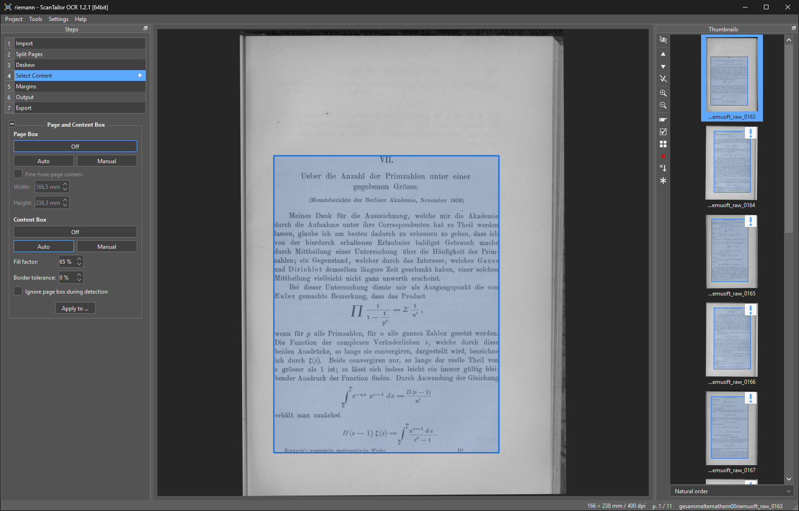

# 4 Select Content

This step finds two rectangles on each page:

- the **page box**: where the sheet of paper is, and
- the **content box** (blue): the text and pictures that belong in the output.

Everything outside the content box is treated as margin. In the *Output* step it is
filled with the background color, so dirt, shadows and the edge of the facing page
disappear.

{ .shot }

## Page Box

| Mode | Meaning |
|---|---|
| **Off** | The whole image is the page. |
| **Auto** | Detects the edges of the paper. |
| **Manual** | Keeps the box you set, in the image or with **Width** and **Height**. |

**Fine-tune page corners** shrinks the detected page box from each corner as long as the
corner lies on a dark area, such as the scanner background visible in the corners of a
page placed askew.

The page box is mainly useful with dark scanner backgrounds. With a white background or
single sheets, *Off* is usually fine.

## Content Box

| Mode | Meaning |
|---|---|
| **Off** | The whole page box is the content box. |
| **Auto** | Detects the content. |
| **Manual** | Keeps the box you drew. |

### Settings of the automatic detection

| Setting | What it does | When to change it |
|---|---|---|
| **Fill factor** | The highest share of black pixels a line may have to still count as text. Lines that are darker are taken for shadows or edges and left out. | Raise it for art books and photo pages: above 85 %, shadows are kept and pictures count as content; from 95 % on, the whole page box becomes the content box. |
| **Border tolerance** | How much of the content touching the image border is kept. At 0 %, it is removed (scanner edges, shadows). | Raise it for pictures that reach the edge of the page. |
| **Ignore page box during detection** | Searches for content in the whole image, not only inside the page box. The content box still stays inside the page box. | Text close to the edge of the page box is not detected. |

The automatic detection works on a version of the page in which uneven paper has been
evened out, so shadows at the spine and yellowed edges are rarely taken for content.

## Working with the mouse

- **Drag** a side or corner of a box to resize it.
- Hold ++shift++ and drag to **move** a box.
- **Double-click** on some content to fit the content box to it automatically.
- The **context menu** (right click) creates or removes the content box.

!!! tip "Finding the problem pages"
    Sort the thumbnails by **decreasing deviation**, by width or by height. Pages whose
    content box is much larger or smaller than the others (a page number missed, a stain
    included) then come first.

If content is cut off on pages with columns, check *Split Pages* first: a split line set
by hand and applied to the other pages often solves it.

**Apply to ...** copies the page box, the content box (with the detection settings) or
both to other pages.
