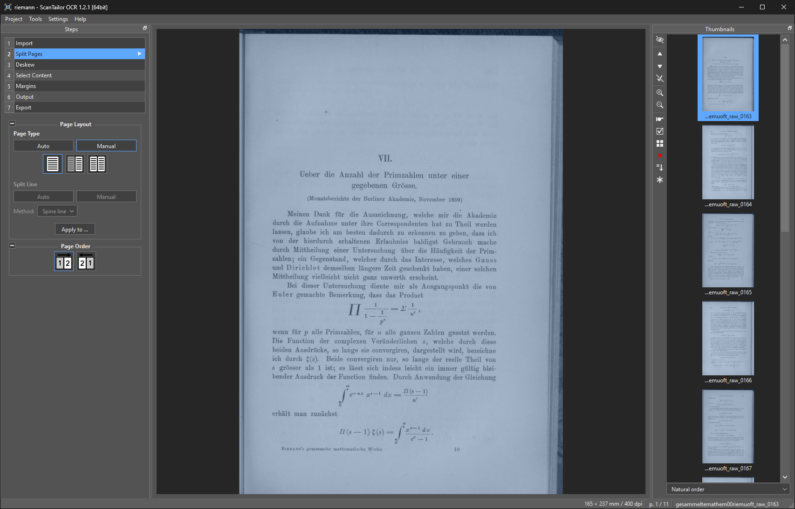

# 2 Split Pages

A book scanned open on a flatbed scanner gives two pages per image. This step decides
how each scan is divided and where the split line runs.

{ .shot }

## Page Layout

### Page type

**Auto** detects the type of each scan. **Manual** keeps the type you choose with the
three buttons:

| Button | Page type | Use it for |
|---|---|---|
| One page | Not split | Single pages, e.g. from a document feeder |
| One page and a strip | One page, a strip on one side is cut off | Single pages with the edge of the facing page in the scan |
| Two pages | Split into two | Open books scanned as a spread |

### Split line

**Auto** detects the split line; **Manual** keeps the line where you dragged it. Drag
the line or its handles in the page view. The line may be slanted.

**Method** chooses how the line is found automatically:

- **Spine line** looks for the spine as a thin line that is darker than both sides of
  it, over the whole height of the page, also slightly tilted. If it finds none, it
  falls back to *Edges*. This is the default for new pages.
- **Edges** takes the vertical line closest to the center. That can also be the edge of
  a photo or of a text column, so it is more easily misled.

!!! tip "Multi-column pages"
    If a page has columns, automatic detection may take a gap between columns for the
    spine. Set the split line by hand on one page and apply it with
    **Apply to ... > Split line position** to the others.

**Apply to ...** copies the *page type*, the *split line position* (adapted to the
size of each page) and the *detection method* to other pages.

## Page Order

For the whole project: which half of a split scan comes first.

- **Left first**, as in most books.
- **Right first**, as in Hebrew, Arabic or Japanese books.

Switching renames the existing output files, whose names contain the order, so nothing
has to be processed again. New projects start with the order set in the
[Default Parameters](../reference/default-parameters.md).
